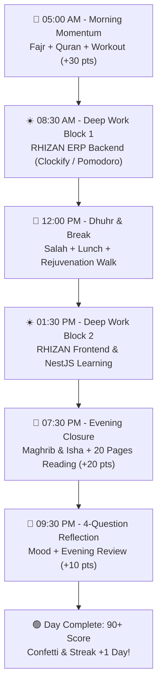

# PROJECT 90 — User Manual & Operational Blueprint

> **"Build Your Life, One Day at a Time."**

Welcome to **PROJECT 90**, your personal life operating system designed to transform your spiritual discipline, physical health, digital habits, career execution, and personal order across a structured 90-day sprint.

---

## 📖 Table of Contents
1. [Core Philosophy & 5 Life Pillars](#1-core-philosophy--5-life-pillars)
2. [A Complete Day in the Life (Practical Use Case)](#2-a-complete-day-in-the-life-practical-use-case)
3. [Module-by-Module User Guide](#3-module-by-module-user-guide)
   - [Clockify-Style Time Tracker & Pomodoro](#-clockify-style-time-tracker--pomodoro)
   - [Habits & 100-Point Daily Scorecard](#-habits--100-point-daily-scorecard)
   - [Routines & Guided Focus Runner](#-routines--guided-focus-runner)
   - [Daily Timeline](#-daily-timeline)
   - [90-Day Calendar Matrix & Day Inspector](#-90-day-calendar-matrix--day-inspector)
   - [Analytics & Reports](#-analytics--reports)
   - [Daily Reflection & Evening Journal](#-daily-reflection--evening-journal)
   - [Goals & Weekly Sprint Reviews](#-goals--weekly-sprint-reviews)
   - [Achievements & Gamification](#-achievements--gamification)
   - [Settings, MongoDB Atlas & Better Auth](#-settings-mongodb-atlas--better-auth)
4. [Keyboard Shortcuts & Command Palette (`Ctrl + K`)](#4-keyboard-shortcuts--command-palette-ctrl--k)

---

## 1. Core Philosophy & 5 Life Pillars

PROJECT 90 integrates five core life dimensions into a unified scorecard:

| Pillar | Focus Areas | Target Habits & Metrics |
| :--- | :--- | :--- |
| **🕌 Spiritual** | 5 Daily Salah, Quran Tilawat & Tadabbur, Adhkar, Islamic Study | Pray on time, 5+ pages Quran daily |
| **📱 Digital Discipline** | Screen-time control, No mindless scrolling, Phone-free deep work | &lt; 2h phone screen time, First 90 min offline |
| **👤 Personal** | Early rising, Strategic planning, Reading 20+ pages, Clean space | 5:00 AM wake up, Evening sleep protocol |
| **💪 Health** | Strength workout, 8,000 steps, 3L water hydration, Clean eating | 45m workout, 3 Liters pure water daily |
| **💻 Career** | RHIZAN ERP engineering, Tech mastery (NestJS/React), Client deliverables | 4+ hours deep focused engineering |

---

## 2. A Complete Day in the Life (Practical Use Case)

Follow this structured daily blueprint to guarantee an **🟢 Excellent (90+) Score** every single day:

### Phase 1: 🌅 Morning Momentum (05:00 AM – 07:00 AM)
1. **05:00 AM Alarm**: Wake up, drink 500ml water, perform Wudu, and walk to the mosque for Fajr in congregation.
2. **Quran Tilawat**: Recite 5 pages of the Quran with contemplation.
3. **Physical Vitality**: Complete 35 minutes of calisthenics or gym training + cold shower and high-protein breakfast.
4. **Log in PROJECT 90**:
   - Open app on `http://localhost:3000/`.
   - On the Dashboard, click **Launch Guided Routine** on the *Morning Momentum Routine*.
   - Click through the steps as you complete them, then click **Log to Timeline & Close**.
   - *Result: +30 Points earned before 7:00 AM!*

### Phase 2: ☀️ High-Impact Deep Work (08:30 AM – 05:00 PM)
1. **Strategic War-Room Planning**: Review your top 3 daily objectives.
2. **Clockify Time Tracking**:
   - In the global bottom timer bar (or *Time Tracker* tab), enter: `RHIZAN ERP Multi-tenant Backend`.
   - Select Category: `💻 Career` and Project: `RHIZAN ERP`.
   - Toggle **Stopwatch** or **50m Pomodoro** and click **Start**.
3. **Phone-Free Focus**: Place your phone in another room or turn on Do Not Disturb.
4. **Salah Checks**: Glance at the Topbar Prayer Times countdown for Dhuhr (11:58 AM) and Asr (03:26 PM).
5. **Stop & Log**: Click **Stop** when finishing a block. The session is automatically saved to MongoDB Atlas, updating your daily productive time chart.
   - *Result: 4+ Hours of verified deep work logged!*

### Phase 3: 🌙 Evening Closure & Reflection (07:30 PM – 10:00 PM)
1. **Prayers & Family**: Maghrib and Isha prayers; family dinner with zero phone scrolling.
2. **Reading Habit**: Read 20 pages of non-fiction / technical architecture books -> click **Done** on the *Reading* habit.
3. **Daily Reflection Protocol**:
   - Go to the **Daily Reflection** tab.
   - Select your mood: 😊 **Great**, 🙂 **Good**, 😐 **Normal**, or 😞 **Bad**.
   - Answer the 4 core questions:
     1. *What did I do well today?*
     2. *What did I fail to do?*
     3. *What distracted me?*
     4. *What will I improve tomorrow?*
   - Click **Save Reflection & Score (+10 pts)**.
   - *Result: Daily Score reaches 90+ 🟢 Excellent, triggering celebratory fanfare and confetti!*
4. **Lights Out**: Phone docked in the living room at 09:45 PM; lights out by 10:15 PM.

### Phase 4: 📋 Sunday Evening Weekly Review
1. Press <kbd>Ctrl + K</kbd> and select **Launch Weekly Sprint Review**.
2. Review your 7-day average score, deep work hours, best category, and weakest area.
3. Write your weekly retrospective and set targets for the upcoming sprint.

---

## 3. Module-by-Module User Guide

### ⏱️ Clockify-Style Time Tracker & Pomodoro
- **Global Bottom Bar**: Always accessible across every screen with a live red pulse ticker (`01:24:36`), activity title input, category & project dropdowns, and start/pause/stop controls.
- **Pomodoro Mode**: Switch between standard stopwatch and 25m/50m Pomodoro countdowns.
- **Manual Time Entry**: Click `+` to add offline sessions with custom start, end, and duration times.
- **CSV Export**: Export all historical time entries as a clean `.csv` spreadsheet anytime.

### ⚡ Habits & 100-Point Daily Scorecard
- Habits carry weighted points (e.g. Salah 20pt, RHIZAN 15pt, Workout 15pt, Quran 10pt, Reflection 10pt = 100 max daily points).
- 3 State toggles:
  - `✅ Done`: Full points awarded + sound chime.
  - `⏳ In Progress`: 50% partial points.
  - `❌ Skip`: Zero points.
- **Score Tiers**:
  - 🟢 **90–100 Points**: Excellent (Peak Discipline)
  - 🔵 **70–89 Points**: Good (Solid Momentum)
  - 🟡 **50–69 Points**: Average (Needs Push)
  - 🔴 **Below 50 Points**: Needs Immediate Fix

### 🔄 Routines & Guided Focus Runner
- Pre-configured with **Morning Momentum** 🌅, **Work Routine** ☀️, and **Evening Wind-down** 🌙.
- Click **Launch Guided Runner** to enter a distraction-free full-screen runner with step timers and auto-logging upon completion.

### 🕒 Chronological Daily Timeline
- Visual 24-hour timeline displaying all morning habits, time entries, deep work blocks, and reflections in exact chronological sequence.

### 🗓️ 90-Day Calendar Matrix & Day Inspector
- 90 color-coded day cells representing your entire transformation sprint.
- Click any day (e.g. Day 5 or Day 12) to open the **Day Inspector Modal** displaying habits status, time logs, and journal reflections.

### 📊 Analytics & Reports
- Category time allocation bars (Spiritual, Digital, Personal, Health, Career).
- Project distribution logs (RHIZAN, NestJS learning, workout, etc.).
- 12-Day Score Progression chart.

### 🎯 Goals & 🏆 Achievements
- Set weekly targets (e.g. *RHIZAN Deep Work 40h/week*, *Exercise 5 days/week*).
- Unlock gamified achievement badges (7-Day Streak, 30 Days Strong, 100 Hours Deep Work, Career Machine).

### 💾 Settings, MongoDB Atlas & Better Auth
- Seamless account registration and login powered by **Better Auth**.
- Live synchronization to **MongoDB Atlas** cluster (`cluster0.7mbwqf2.mongodb.net/project90`).
- Export JSON backups or reset to Day 12 demonstration seed data.

---

## 4. Keyboard Shortcuts & Command Palette (`Ctrl + K`)

| Shortcut | Action |
| :--- | :--- |
| <kbd>Ctrl + K</kbd> or <kbd>Cmd + K</kbd> | Open Spotlight Command Palette |
| <kbd>Alt + T</kbd> | Quick Start / Stop Active Timer |
| <kbd>Alt + M</kbd> | Toggle Dark / Light Color Theme |
| <kbd>ESC</kbd> | Close Any Open Modal or Drawer |
