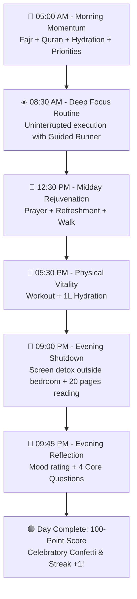

# PROJECT 90 — Routine & Dynamic Pillars Life OS

> **"Build Your Life, One Routine at a Time."**

Welcome to **PROJECT 90**, your mobile-first personal life operating system designed to build unbreakable discipline through **Dynamic Focus Pillars** and **Structured Daily Routine Tracking** across a 90-day transformation sprint.

---

## 📖 Table of Contents
1. [Core Philosophy & Dynamic Focus Pillars](#1-core-philosophy--dynamic-focus-pillars)
2. [A Complete Day in the Life (Practical Blueprint)](#2-a-complete-day-in-the-life-practical-blueprint)
3. [Key Features & System Guide](#3-key-features--system-guide)
   - [Dynamic Focus Pillars Management](#-dynamic-focus-pillars-management)
   - [Today's Execution Board & Quick Check](#-todays-execution-board--quick-check)
   - [Guided Routine Runner Modal](#-guided-routine-runner-modal)
   - [24-Hour Daily Timeline](#-24-hour-daily-timeline)
   - [90-Day Sprint Calendar Matrix](#-90-day-sprint-calendar-matrix)
   - [Evening 4-Question Reflection & 100-Point Score](#-evening-4-question-reflection--100-point-score)
   - [Mastery Badges & Streaks](#-mastery-badges--streaks)
4. [Mobile-First & PWA Installation Guide](#4-mobile-first--pwa-installation-guide)
5. [Keyboard Shortcuts & Command Palette (`Ctrl + K`)](#5-keyboard-shortcuts--command-palette-ctrl--k)

---

## 1. Core Philosophy & Dynamic Focus Pillars

PROJECT 90 doesn't force a rigid, one-size-fits-all set of categories. **You define what matters most to your life.**

* **Register Any Pillar:** Define your own life dimensions (e.g. *Spiritual Discipline*, *Health & Fitness*, *Deep Focus*, *Personal Order*, *Digital Detox*, *Family & Community*).
* **Full Customization:** Give each pillar a distinct emoji icon, theme color, title, and purpose statement.
* **Routine Alignment:** Every routine you create belongs to one of your dynamic pillars, keeping your daily habits purposeful and balanced.

---

## 2. A Complete Day in the Life (Practical Blueprint)

1. **Morning (Phase 1):** Wake up early, hydrate, complete morning prayers and priorities. Check off your *Morning Momentum Protocol* directly from the mobile board or run it with the **Guided Runner**.
2. **Daytime (Phase 2):** Execute your scheduled focus and health routines. Tap **Run Guided** to follow step-by-step checklists with a built-in stopwatch.
3. **Evening (Phase 3):** Put your phone outside the sleeping area, read 20 pages, and open **Review** to log your 4-question evening reflection and complete your daily score.

---

## 3. Key Features & System Guide

### 🏛️ Dynamic Focus Pillars Management
* Click **Manage Pillars** on the Dashboard or in the Routines tab.
* Add new focus areas with custom names, icons, and theme colors.
* Edit or reorganize pillars as your life goals evolve.

### ⚡ Today's Execution Board & Quick Check
* All routines scheduled for today are organized by time of day:
  * 🌅 *Morning Protocol*
  * ☀️ *Afternoon Focus*
  * 🌙 *Evening Shutdown*
  * ⚡ *Anytime*
* **One-Tap Checkbox:** Tap **Complete** on any card to mark it done instantly with haptic/audio confirmation.
* **Filter by Pillar:** Tap any pillar pill at the top of the board to isolate routines belonging to that focus area.

### 🏃 Guided Routine Runner Modal
* Tap **Run Guided** on any routine.
* Walks you through each individual step sequentially (e.g. *Step 1: Drink 500ml water* → *Step 2: Dynamic warmup*).
* Dedicated stopwatch timer for each step with Pause / Resume / Reset controls.
* Complete the final step to trigger fanfare and automatically record the routine to your timeline.

### 🕒 24-Hour Daily Timeline
* Displays an hour-by-hour view of your scheduled and completed routines.
* Click any past date to inspect previous routine logs and notes.

### 🗓️ 90-Day Sprint Calendar Matrix
* A bird's-eye view of all 90 days in your sprint.
* Color-coded status dots:
  * 🟢 **Excellent (90–100 pts):** All scheduled routines + evening reflection completed.
  * 🔵 **Good (70–89 pts):** Strong consistency.
  * 🟡 **Average (50–69 pts):** Partial completion.
  * 🔴 **Needs Work (< 50 pts):** Off-track day.
* Click any day card to open the **Day Detail Inspector**.

### 📝 Evening 4-Question Reflection & 100-Point Score
* Rate your overall mood (😊 Great, 🙂 Good, 😐 Normal, 😞 Tough).
* Answer the 4 reflective questions:
  1. *What did I do well today?*
  2. *What did I fail to do?*
  3. *What distracted me or broke my focus?*
  4. *What will I improve tomorrow?*
* Submitting your reflection awards the final 10 points toward your 100-point total.

### 🏆 Mastery Badges & Streaks
Unlock badges as you achieve consistency milestones:
* ⚡ **First Step:** Complete your first guided routine execution.
* 🏛️ **Pillar Architect:** Register and customize your personal focus pillars.
* 🌅 **Dawn Master:** Complete your morning routine 7 days in a row.
* 🌙 **Night Guardian:** Complete your evening shutdown routine 7 days in a row.
* 🎯 **Flawless Execution:** Complete 100% of all scheduled routines today.
* 🔥 **7-Day Routine Streak:** 7 straight days of full routine execution.
* 🛡️ **30-Day Routine Warrior:** 30 consecutive days of discipline.
* 🌈 **Holistic Harmony:** Complete routines in every active pillar in one day.
* 👑 **90-Day Master Finisher:** Conquer all 90 days of the sprint.

---

## 4. Mobile-First & PWA Installation Guide

PROJECT 90 is an offline-capable **Progressive Web App (PWA)** that installs directly to your phone's home screen like a native app:

### 📱 Installing on iPhone / iPad (Safari)
1. Open `http://<your-host>:3000/` in **Safari**.
2. Tap the **Share** button (box with an arrow pointing up).
3. Scroll down and tap **"Add to Home Screen"**.
4. Tap **Add**. The PROJECT 90 app icon will appear on your home screen and open in full-screen standalone mode.

### 🤖 Installing on Android (Chrome / Brave)
1. Open `http://<your-host>:3000/` in **Chrome**.
2. Tap the three-dot menu in the upper-right corner.
3. Tap **"Install app"** or **"Add to Home screen"**.
4. The app installs with standalone launch support and bottom navigation.

### 💻 Installing on Desktop (Chrome / Edge)
1. Look for the **Install App icon** in the browser URL address bar.
2. Click **Install** to run PROJECT 90 in its own standalone window.

---

## 5. Keyboard Shortcuts & Command Palette (`Ctrl + K`)

| Shortcut | Action |
| :--- | :--- |
| <kbd>Ctrl</kbd> + <kbd>K</kbd> / <kbd>Cmd</kbd> + <kbd>K</kbd> | Open the Command Palette from anywhere |
| <kbd>Alt</kbd> + <kbd>M</kbd> | Toggle between Dark Focus Mode and Light Mode |
| <kbd>ESC</kbd> | Close any open modal or runner |

---

> *"We are what we repeatedly do. Excellence, then, is not an act, but a habit."*
